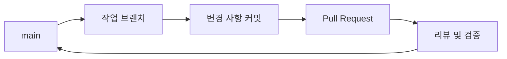

# 기여 가이드

## 개발 환경 설정

1. 저장소를 클론합니다.

   ```sh
   git clone https://github.com/jaimejang0122/oss.git
   cd oss
   ```

2. VS Code에서 저장소를 엽니다.

   ```sh
   code .
   ```

## 이슈 템플릿

새 이슈를 만들 때 목적에 맞는 템플릿을 선택해 주세요.

- 버그를 보고하려면 [Bug Report 템플릿](.github/ISSUE_TEMPLATE/bug_report.md)을 사용합니다.
- 기능을 제안하려면 [Feature Request 템플릿](.github/ISSUE_TEMPLATE/feature_request.md)을 사용합니다.

## 브랜치 전략

이 저장소는 GitHub Flow를 따릅니다. 최신 `main`에서 작업 브랜치를 만들고, 변경 사항을 커밋한 뒤 Pull Request를 열어 리뷰와 검증을 요청합니다. 승인과 검증을 마친 Pull Request를 `main`에 병합합니다.



브랜치 이름은 작업 종류에 맞는 접두사를 사용합니다.

| 접두사 | 용도 |
| --- | --- |
| `feature/*` | 새 기능 개발 |
| `fix/*` | 일반 버그 수정 |
| `hotfix/*` | 긴급 수정 |
| `docs/*` | 문서 변경 |
| `refactor/*` | 동작 변경 없는 코드 개선 |
| `test/*` | 테스트 추가 및 수정 |
| `chore/*` | 빌드, 설정, 유지보수 작업 |